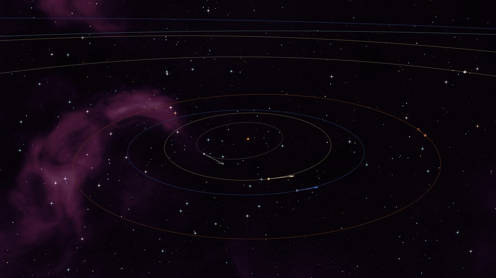
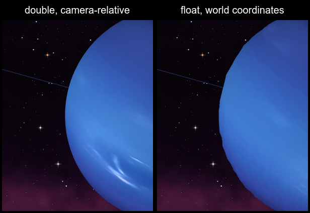

# Epsilon Solar System

The Sun, the eight planets and the Moon at their real sizes and distances, where they are right now, rendered
with OpenGL. A demo of [Epsilon.LinearAlgebra](https://www.nuget.org/packages/Epsilon.LinearAlgebra) and its
symbolic core [Epsilon](https://www.nuget.org/packages/Epsilon) ([source](https://github.com/XBambinoX/Epsilon)),
taken from NuGet like any other package.



## Run

Needs the [.NET 10 SDK](https://dotnet.microsoft.com/download) and a GPU with OpenGL 4.5.

```
dotnet run
```

The simulation starts at the current date and runs at one day per second. At the start it prints Kepler's
equation and the derivatives Epsilon finds for it.

## Controls

| Input | Action |
|---|---|
| `0` - `9` | Go to the Sun (`0`), Mercury ... Neptune (`1` - `8`), the Moon (`9`) |
| Left drag | Turn the camera, or move it around the body it circles |
| Wheel | Zoom, or change the flying speed |
| `W` `A` `S` `D` `E` `Q` | Fly forward, left, back, right, up, down; `Shift` is five times faster |
| `F` | Switch between camera-relative double and float world coordinates |
| `V` | Show or hide the velocity arrows |
| `Esc` | Quit |

## What Epsilon does here

### A world in double, a GPU in float

Distances are real, in kilometers: Neptune is 4.5 billion km from the Sun. A float has a 24-bit mantissa, so at
that distance it can only tell positions apart by 512 km, and at Earth's by 16 km. So the whole world is kept in
`Vector3<double>`, `Quaternion<double>` and `Matrix4x4<double>`. Every frame it is moved so that the camera sits
at the origin, and only then turned into float for the GPU with `.Map(float.CreateTruncating)`: near the camera
the numbers are small, and a float is exact enough there.

`F` shows what an engine that keeps its world in float would draw:



### Reverse-Z with the far plane at infinity

```csharp
Matrix4x4<double>.Perspective(fieldOfView, aspect, 0.001, double.PositiveInfinity, DepthRange.OneToZero)
```

Depth runs from 1 at the near plane to 0 at infinity, and with `glClipControl(ZeroToOne)` and a float depth
buffer its precision is spread evenly over distance: the near plane can be one meter away and the far plane at
infinity, in a scene 30 au across.

### Orbits from symbolic derivatives

Positions come from Kepler's equation `M = E - e sin E`, solved by Newton's method. Epsilon finds the derivative
it needs, and the velocities follow by implicit differentiation and the chain rule
([`Orbit.cs`](Orbit.cs)):

```csharp
Kepler = E - Eccentricity * new Sin(E) - M;                                  // zero at the answer
KeplerSlope = Kepler.Differentiate("E");                                     // 1 - e cos E, for Newton's method
AnomalyRate = (-Kepler.Differentiate("M") / KeplerSlope).Simplify();         // dE/dM = 1 / (1 - e cos E)
VelocityX = (PlaneX.Differentiate("E") * AnomalyRate).Simplify();            // dx/dM = dx/dE * dE/dM
```

The orbit lines are drawn from the same expressions as the positions of the bodies.

### Rotations and the camera

| What | Epsilon |
|---|---|
| A body's axis and spin (IAU pole and prime meridian) | `Quaternion.RotationX`, `RotationZ`, products of quaternions |
| An orbit's plane (node, inclination, perihelion) | `RotationZ(node) * RotationX(i) * RotationZ(perihelion - node)` |
| Model and normal matrices | `Matrix4x4.Compose(position, rotation, scale)`, `NormalMatrix()` |
| Camera | `LookAt`, `FromEulerAngles(..., EulerOrder.XYZ)`, `ToEulerAngles` |
| Going to another body | `Slerp` toward it, as long as `Angle` says; then the distance shrinks by the same factor every moment |
| Velocity arrows | `FromToRotation(UnitX, velocity)`, `Compose` |
| Sky and stars | `(projection * view).Inverse()`, the galactic pole turned into the ecliptic frame |

Epsilon matrices store their entries row by row and GLSL reads them column by column, so a matrix goes to the
GPU as it is, with `transpose = true`; arrays of `Vector3<float>` go to vertex buffers as they are.

## Data and accuracy

- Planets: the Keplerian elements and their rates from Table 1 of JPL's
  [Approximate Positions of the Planets](https://ssd.jpl.nasa.gov/planets/approx_pos.html), valid from 1800 to
  2050. Earth's row is the Earth-Moon barycenter; Earth is placed off it, opposite the Moon.
- Moon: mean elements from Meeus, *Astronomical Algorithms*, chapter 47, without the periodic terms, so it can be
  off by a few degrees.
- Spin and orientation: the IAU WGCCRE reports (2009; Mercury 2015) without their small periodic terms. Earth's day
  side faces the Sun at the current time, and the Moon shows Earth its near side.
- Velocities leave out the slow turning of the orbits themselves: under 0.2% for the planets, about 1% for the Moon.
- The stars and the nebulae are made up; the Milky Way band lies where the real galactic plane is.
- Left out: Saturn's rings, Earth's night lights and clouds.

## Credits

The planet maps are by [Solar System Scope](https://www.solarsystemscope.com/textures/), licensed under
[CC BY 4.0](https://creativecommons.org/licenses/by/4.0/) (see [`Textures/README.md`](Textures/README.md)).
The code is under the [MIT License](LICENSE).
